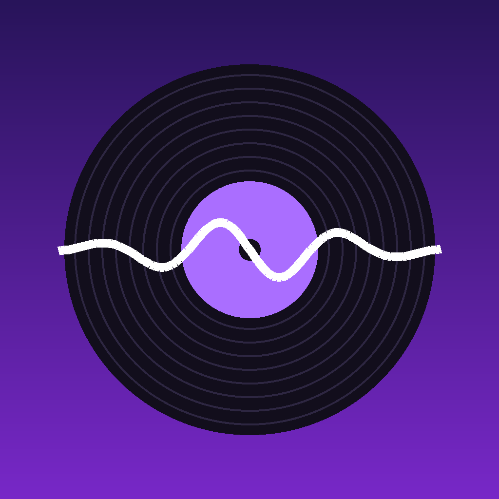

  

<h1 align="center">Slowed</h1>

  <b>Slowed + Reverb en un toque, para tu iPhone.</b> 
  <b>One-tap Slowed + Reverb for your iPhone.</b>

  
  
  
  

  
  
  

---

## 🇪🇸 Español

### ¿Para qué es?
**Slowed** convierte cualquier canción de tu biblioteca en **slowed + reverb**, **nightcore** o **daycore** al instante, sin editar nada ni subir archivos a ninguna web. Ajusta el ecualizador y los efectos a tu gusto, sigue la **letra sincronizada** como en Apple Music y escucha tu propia colección **offline**, incluso **FLAC hi-res de 24-bit**.

Sin anuncios, sin cuenta, sin suscripción. Gratis y open source.

### Funciones
- 🐢 **Slowed + Reverb en un toque**: velocidad de 0.5x a 1.5x con tono tipo vinilo (o mantén el tono), tono extra ±12 semitonos, cantidad de reverb y 8 tipos de sala. Presets: Slowed, Super slowed, Daycore, Nightcore y Solo reverb.
- 🎚️ **Ecualizador de 10 bandas** con presets (Plano, Bass Boost, Voces, Pop, Rock, Hip-Hop, Electrónica…) y bass boost aparte.
- 🎧 **Efectos extra**: audio 8D, eco y «bajo el agua».
- 🎤 **Letras sincronizadas**: de las etiquetas del archivo (ID3, iTunes, FLAC), de un archivo `.lrc` o de LRCLIB.net. La línea actual se resalta y se desplaza sola; toca una línea para saltar ahí.
- 🖼️ **Pantalla «Reproduciendo» estilo Apple Music**: portada a todo el ancho con los colores del disco, barra de progreso gruesa, formato real del audio (p. ej. «FLAC · 24-bit · 96 kHz») y AirPlay.
- 💿 **Tu biblioteca**: importa MP3, M4A, WAV, AIFF y FLAC desde Archivos o con *Compartir › Abrir en Slowed*. Portada, título, artista, álbum y explícito se leen solos.
- 🔊 **Calidad máxima**: el audio se procesa a la frecuencia nativa del archivo (hasta 192 kHz) y los efectos apagados no tocan la señal.
- 📤 **Exporta** una canción con los efectos aplicados y compártela.
- ✨ **Liquid Glass** en iOS 26, modo oscuro/claro/sistema y 7 idiomas.
- ▶️ Audio en segundo plano, controles en la pantalla de bloqueo y el Centro de control, cola, aleatorio y repetir.

### Instalar
La IPA no está firmada: se instala con **AltStore** o **SideStore**, que la firman con tu Apple ID. No necesitas Mac.

**Opción 1: añadir la fuente (recomendado, recibes las actualizaciones)**
1. Ten AltStore o SideStore instalado en el iPhone.
2. Abre en el iPhone [Añadir a AltStore](https://harvlo.github.io/mornye-slowed-reverb/add/altstore/) o [Añadir a SideStore](https://harvlo.github.io/mornye-slowed-reverb/add/sidestore/).
   O en *Sources › +* pega: `https://raw.githubusercontent.com/Harvlo/mornye-slowed-reverb/main/altstore/apps.json`
3. Instala **Slowed** desde la fuente.

**Opción 2: IPA directa**
1. Descarga [Slowed.ipa](https://github.com/Harvlo/mornye-slowed-reverb/releases/latest/download/Slowed.ipa) en Safari (se guarda en Archivos).
2. En AltStore o SideStore › *My Apps* toca **+** y elige `Slowed.ipa`.

**AltStore desde Windows (primera vez)**: instala iTunes e iCloud desde la web de Apple (no Microsoft Store) y [AltServer](https://altstore.io), conecta el iPhone por USB o Wi‑Fi e instala AltStore desde el icono de AltServer.

### Preguntas frecuentes
**¿Por qué tengo que refrescar la app cada 7 días?**
Con un Apple ID gratuito, Apple solo firma apps instaladas por tu cuenta durante 7 días. AltStore/SideStore las refrescan solos si los abres de vez en cuando (AltStore necesita AltServer en la misma red).

**¿Por qué mis auriculares Bluetooth no reproducen 96 kHz?**
Slowed procesa el audio a la frecuencia original del archivo, pero el Bluetooth (AirPods incluidos) y el altavoz del iPhone salen a 48 kHz como máximo. Para 96/192 kHz reales necesitas un DAC USB‑C externo.

**¿De dónde salen las letras?**
En este orden: un `.lrc` importado en la app, un `.lrc` con el mismo nombre que la canción, las etiquetas del archivo y, si está activado en Ajustes, [LRCLIB](https://lrclib.net). Se puede desactivar la búsqueda en internet.

**¿Recoge datos?**
No. No hay cuenta, ni anuncios, ni analíticas. Solo se conecta a internet para buscar letras en LRCLIB si lo tienes activado.

---

## 🇬🇧 English

### What is it for?
**Slowed** turns any song in your library into **slowed + reverb**, **nightcore** or **daycore** instantly, with no editing and no uploading to websites. Tune the equalizer and effects to your taste, follow **synced lyrics** like in Apple Music, and play your own collection **offline**, including **24-bit hi-res FLAC**.

No ads, no account, no subscription. Free and open source.

### Features
- 🐢 **One-tap Slowed + Reverb**: 0.5x–1.5x speed with vinyl-style pitch (or keep pitch), extra pitch ±12 semitones, reverb amount and 8 room types. Presets: Slowed, Super slowed, Daycore, Nightcore and Reverb only.
- 🎚️ **10-band equalizer** with presets (Flat, Bass Boost, Vocals, Pop, Rock, Hip-Hop, Electronic…) plus a separate bass boost.
- 🎧 **Extra effects**: 8D audio, echo and "underwater".
- 🎤 **Synced lyrics**: from file tags (ID3, iTunes, FLAC), an `.lrc` file or LRCLIB.net. The current line is highlighted and auto-scrolls; tap a line to jump there.
- 🖼️ **Apple Music-style Now Playing**: edge-to-edge artwork with its colors, thick progress bar, the real audio format (e.g. "FLAC · 24-bit · 96 kHz") and AirPlay.
- 💿 **Your library**: import MP3, M4A, WAV, AIFF and FLAC from Files or via *Share › Open in Slowed*. Cover art, title, artist, album and explicit flag are read automatically.
- 🔊 **Max quality**: audio is processed at the file's native sample rate (up to 192 kHz) and effects that are off don't touch the signal.
- 📤 **Export** a song with the effects baked in and share it.
- ✨ **Liquid Glass** on iOS 26, dark/light/system appearance and 7 languages.
- ▶️ Background audio, lock screen and Control Center controls, queue, shuffle and repeat.

### Install
The IPA is unsigned: install it with **AltStore** or **SideStore**, which sign it with your Apple ID. No Mac needed.

**Option 1: add the source (recommended, you get updates)**
1. Have AltStore or SideStore installed on your iPhone.
2. On the iPhone, open [Add to AltStore](https://harvlo.github.io/mornye-slowed-reverb/add/altstore/) or [Add to SideStore](https://harvlo.github.io/mornye-slowed-reverb/add/sidestore/).
   Or in *Sources › +* paste: `https://raw.githubusercontent.com/Harvlo/mornye-slowed-reverb/main/altstore/apps.json`
3. Install **Slowed** from the source.

**Option 2: direct IPA**
1. Download [Slowed.ipa](https://github.com/Harvlo/mornye-slowed-reverb/releases/latest/download/Slowed.ipa) in Safari (it's saved to Files).
2. In AltStore or SideStore › *My Apps* tap **+** and pick `Slowed.ipa`.

**AltStore on Windows (first time)**: install iTunes and iCloud from Apple's website (not the Microsoft Store) and [AltServer](https://altstore.io), connect the iPhone by USB or Wi‑Fi and install AltStore from the AltServer tray icon.

### FAQ
**Why do I need to refresh the app every 7 days?**
With a free Apple ID, Apple signs self-installed apps for 7 days only. AltStore/SideStore refresh them automatically if you open them now and then (AltStore needs AltServer on the same network).

**Why don't my Bluetooth headphones play 96 kHz?**
Slowed processes audio at the file's original sample rate, but Bluetooth (AirPods included) and the iPhone speaker output 48 kHz at most. For true 96/192 kHz you need an external USB‑C DAC.

**Where do the lyrics come from?**
In this order: an `.lrc` imported in the app, an `.lrc` with the same name as the song, the file's tags and, if enabled in Settings, [LRCLIB](https://lrclib.net). Online lookup can be turned off.

**Does it collect data?**
No. No account, no ads, no analytics. It only goes online to look up lyrics on LRCLIB when that's enabled.

---

## Build
Every push to `main` builds the unsigned IPA on GitHub Actions ([`build-ipa.yml`](.github/workflows/build-ipa.yml)) with XcodeGen and Xcode 26, publishes it as the latest release and updates the AltStore/SideStore source in [`altstore/apps.json`](altstore/apps.json). SwiftUI + AVAudioEngine, iOS 16+.

## Credits
- Lyrics by [LRCLIB](https://lrclib.net), a free and open lyrics database.
- Built with SwiftUI, AVAudioEngine and [XcodeGen](https://github.com/yonaskolb/XcodeGen).

## License
[MIT](LICENSE) © Harvlo
